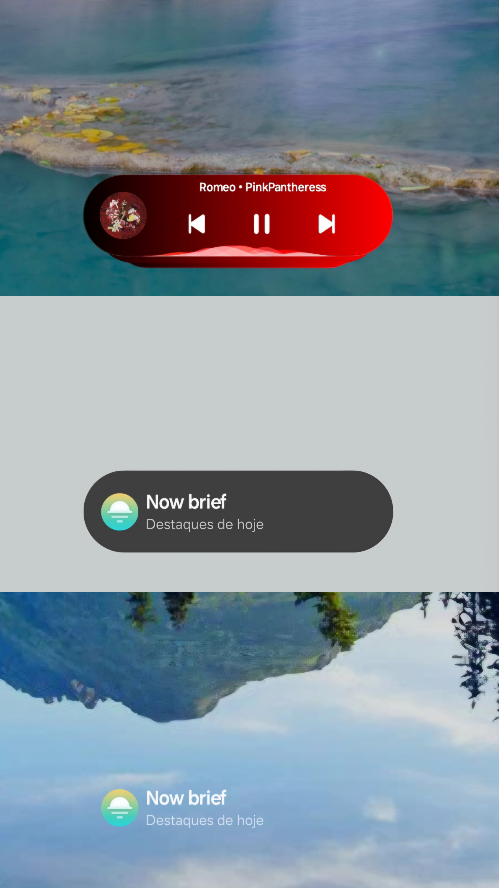

<div align="center">


# Now Bar Color

**Customize the collapsed Now Bar capsule background natively on Samsung One UI 8.0, 8.5, and 9.0+ (Lock Screen & AOD)**

[](https://github.com/TAVATAAN/OneUI-Now-Bar-Color/releases)
[](https://modules.lsposed.org/module/io.github.tavataan.nowbarcolor)
[](https://github.com/TAVATAAN/OneUI-Now-Bar-Color/releases/latest)
[](#features)
[](LICENSE)

</div>

---

## Overview

**Now Bar Color** is an adaptive Xposed/LSPosed module for rooted Samsung Galaxy devices running **One UI 8.0, 8.5, and One UI 9.0+**. Starting with **v2.0.0**, it ships as a **single universal APK with isolated version adapters** powered by on-device **DexKit** bytecode scanning—operating directly on your stock `SystemUI` and `AOD_Service` without replacing system APKs or flashing root ZIPs.

It gives you full control over collapsed Lock Screen and Always On Display (AOD) Now Bar capsule backgrounds—solid colors, calibrated One UI 8.5-style glass **Color Blur**, smooth two-stop horizontal gradients, and wallpaper-adaptive palettes—while keeping album art, icons, controls, text legibility, and native animations intact.

It also includes a native One UI companion app featuring a live interactive capsule preview stage, real-time animated audio waveforms, squircle vector badges with live color cutouts, per-category toggles, independent opacity and blur/tint sliders, built-in compatibility diagnostics, and **English, Spanish, and Portuguese** localization.

> [!NOTE]
> **Early-Stage Project Notice, Tested Devices & Active Updates**
>
> This project is still **very new and actively maintained**, so visual glitches or firmware-specific bugs can still appear on untested Galaxy models or `AOD_Service` builds. Future updates will keep rolling out to improve compatibility and polish.
>
> **v2.0.0 has only been directly tested on:**
> - **Samsung Galaxy S23 Ultra** — **One UI 9.0**
> - **Samsung Galaxy S20 FE** — **One UI 8.5**
> - **Samsung Galaxy S22 Ultra** — **One UI 8.0**
>
> If you spot any bug, missing controls, reverted colors, or have a question on another device/build, please message me on Telegram **[@Tava_Mon97](https://t.me/Tava_Mon97)** (use **Copy Diagnostics** inside the app if reporting an issue) or open an issue on GitHub!

---

## Screenshots & Examples

Examples showing how custom colors, gradients, and glass blur effects blend dynamically with lock screen wallpapers and capsule categories:

<div align="center">

| Solid & Adaptive Palettes | Two-Stop Gradients | Frosted Blur & Companion UI |
| :---: | :---: | :---: |
|  |  |  |

</div>

---

## Compatibility & Downloads (`v2.0.0`)

**v2.0.0 works natively out of the box with a single APK (`NowBarColor.apk`)** across stock **One UI 8.0, 8.5, and 9.0+** (`arm64-v8a`):

- **No separate `AOD_Service` APK required:** `AodScanner` inspects your installed `com.samsung.android.app.aodservice` via **DexKit**, caches a per-build `HookMap`, and automatically selects the isolated adapter for your One UI generation (`OneUi80Adapter`, `OneUi85Adapter`, or `OneUi9Adapter`).
- **No root Suite ZIP required or recommended:** Do **not** flash legacy v1.3 root ZIPs over stock One UI 8.0 / 8.5 / 9.0+ ROMs—`v2.0.0` runs natively through LSPosed / Vector alone. *(Legacy v1.3.0 files are no longer bundled in v2.0.0 and remain archived strictly in the old [`4-1.3.0`](https://github.com/TAVATAAN/OneUI-Now-Bar-Color/releases/tag/4-1.3.0) release.)*

All official v2.0.0 builds are published across GitHub Releases and the LSPosed / Vector module catalog:

| Channel / Target | File / Catalog Entry | Description | Link |
| :--- | :--- | :--- | :--- |
| **GitHub Releases (`5-2.0.0`)** | `NowBarColor.apk` | Universal Adaptive Module APK (`v2.0.0`, `versionCode 5`) | [Download APK (v2.0.0)](https://github.com/TAVATAAN/OneUI-Now-Bar-Color/releases/download/5-2.0.0/NowBarColor.apk) |
| **LSPosed & Vector Repo** | `io.github.tavataan.nowbarcolor` | Official online repository listing & in-manager updates | [View in LSPosed / Vector Repo](https://modules.lsposed.org/module/io.github.tavataan.nowbarcolor) |

---

## Installation Guide

1. Ensure **LSPosed** (or **Vector** / JingMatrix fork) is installed and active on your rooted Samsung Galaxy device running **One UI 8.0, 8.5, or 9.0+**.
2. Download and install [`NowBarColor.apk` (v2.0.0)](https://github.com/TAVATAAN/OneUI-Now-Bar-Color/releases/download/5-2.0.0/NowBarColor.apk) directly from GitHub Releases or from the **LSPosed / Vector Repository**. *(Uses the same signing key as v1.3.0, so updating in place works cleanly.)*
3. Open **LSPosed Manager** (or **Vector Manager**), enable **Now Bar Color**, and make sure its recommended scopes are checked:
   - **`System UI`** (`com.android.systemui`)
   - **`Always On Display`** (`com.samsung.android.app.aodservice`)
4. Open **Now Bar Color** once so DexKit can inspect and cache the `HookMap` for your device's `AOD_Service` build, then reboot or restart System UI (`su -c killall com.android.systemui`).
5. Customize global or per-capsule colors, gradients, blur radius, tint opacity, and check live hook health in the **Diagnostics** section inside the app.

---

## Features

### Visual Finish Modes & Adaptive Palettes

| Finish Modes | Adaptive Wallpaper Extraction |
| :--- | :--- |
| **Pure Solid Color:** Crisp, high-contrast solid capsule backgrounds with per-category opacity. | **Bottom Zone:** Samples the exact lower lock screen wallpaper region behind the Now Bar. |
| **Two-Stop Horizontal Gradients:** Smooth custom or preset two-color gradients globally or per capsule. | **Monet Accent:** Pulls Samsung's dynamic Material You system accent palette. |
| **One UI 8.5 Glass Color Blur:** Calibrated `16px–100px` frosted blur (default `~60%` / `~65px`), dedicated **Tint Opacity** slider (`25%–85%`, default `~60%`), saturated `SemBlurInfo` ColorCurve rendering, and a subtle `~1dp` diagonal specular glass rim + surface sheen mirrored in the live preview stage. | **Dominant Background:** Matches the primary lock screen wallpaper color tone. |

### Granular Per-Category Control with Dynamic Vector Badges

Each of the **10 Now Bar capsule categories** includes a large One UI squircle badge with transparent vector cutouts dynamically backed by its active color or gradient, plus independent toggles, color overrides, and opacity sliders:

| Category | Target Component / Scope |
| :--- | :--- |
| **1. Music & Media Playback** | `NowBarMediaCardView` |
| **2. Clock, Timer & Stopwatch** | Standard & ongoing clock capsules |
| **3. Voice Recorder & Audio Memos** | Active recording chips |
| **4. Flashlight** | Quick toggle active capsule |
| **5. Live Battery & Charging** | `NowBarBatteryCardView` |
| **6. Now Brief / Galaxy AI Suggestions** | `NowBarBriefCardView` |
| **7. Ongoing Phone Calls** | Active call status capsule |
| **8. Modes & Routines** | Active Bixby/System modes |
| **9. Sports, Maps & Samsung Health** | Navigation, live scores & workouts |
| **10. Other Live Activities** | Interpreter, Smart View & third-party ongoing chips |

### Under-the-Hood Architecture & Companion App

- **1 APK + Isolated One UI Adapters:** `AodScanner` uses native **DexKit** to resolve obfuscated `AOD_Service` / `FaceWidget` classes, methods, and fields on first run, persists a schema-versioned `HookMap` via `NowBarConfigProvider`, and dispatches cleanly through `NowBarAdapterFactory` to `OneUi80Adapter` (8.0), `OneUi85Adapter` (8.5), or `OneUi9Adapter` (9.0+).
- **Zero-Lag Frame-0 Styling & Wake Recovery:** Hooks inside `NowBarCardStackView` and capsule lifecycle paths style cards from frame 0, suppress Samsung's native `NowBarCardGradientView` chip overlay, preserve controls in One UI 8.5 foreground state, and prevent factory-color resets during One UI 8.0 expand/collapse and wake/unlock transitions.
- **Native One UI Companion App:** Features an interactive `CapsulePreviewStage` replicating real wallpaper blur + glass sheen, animated `OneUIMediaCapsuleView` waveforms, `OneUIFloatingBar` navigation, `HsvColorPickerView`, built-in diagnostics export, and an in-app **EN / ES / PT** language switcher.

---

## Building from Source

The repository includes a self-contained Python build pipeline (`build.py`) compatible with Linux, Android (Termux/AGY), and desktop environments with Android SDK build tools (`android-34` + `build-tools/34.0.0`):

```bash
# 1. Clone the repository
git clone https://github.com/TAVATAAN/OneUI-Now-Bar-Color.git
cd OneUI-Now-Bar-Color

# 2. Run the host verification test suite (optional)
python3 tests/run_host_tests.py --android-jar <path-to-android.jar>

# 3. Build and sign the APK
python3 build.py
```

The signed APK is output to:

```text
build/NowBarColor.apk
```

---

## Project Structure

```text
├── AndroidManifest.xml             # Package definition, provider, permissions & Xposed metadata
├── assets/                         # Module bootstrap (xposed_init) and preview album art
├── docs/screenshots/               # Showcase screenshots for GitHub & LSPosed/Vector catalog
├── libs/                           # Bundled DexKit native library (arm64-v8a) & runtime JARs
├── meta_xposed/                    # LSPosed/Vector repository metadata (module.prop, scope.list)
├── res/                            # Vector capsule icons, launcher icon, strings & arrays
├── src/io/github/tavataan/nowbarcolor/
│   ├── MainActivity.java           # One UI settings UI, diagnostics card & category controls
│   ├── NowBarHook.java             # LSPosed entry point & SystemUI/AOD multi-layer hook engine
│   ├── AodScanner.java             # On-device DexKit bytecode scanner for AOD_Service builds
│   ├── HookMap.java                # Schema-versioned cache of discovered classes, methods & fields
│   ├── NowBarConfigProvider.java   # Cross-process ContentProvider sharing settings & HookMap
│   ├── NowBarCardAdapter.java      # Adapter contract decoupling One UI generation differences
│   ├── NowBarAdapterFactory.java   # Runtime adapter selector (One UI 8.0 / 8.5 / 9.0+)
│   ├── OneUi80Adapter.java         # Isolated adapter for One UI 8.0 quirks & wake recovery
│   ├── OneUi85Adapter.java         # Isolated adapter for One UI 8.5 card visibility/blur behavior
│   ├── OneUi9Adapter.java          # Isolated adapter for One UI 9.0+ cards & ColorCurve blur
│   ├── OneUiBlurSpec.java          # Shared blur radius (16-100px) & tint/glass math for hook & UI
│   ├── CapsuleGradient.java        # Adaptive GradientDrawable tracking internal mutations
│   ├── CapsuleStyle.java           # Styling pipeline managing Solid, Color Blur & Gradient fills
│   ├── CapsulePreviewStage.java    # Real-time wallpaper + blur/glass preview stage in the app
│   ├── OneUIFloatingBar.java       # Floating One UI bottom navigation bar component
│   ├── OneUIMediaCapsuleView.java  # Dynamic preview capsule with live audio waveform bars
│   ├── OneUISwitch.java            # Custom Samsung One UI-styled toggle switch
│   ├── HsvColorPickerView.java     # Touch-responsive HSV color picker
│   ├── WallpaperColorHelper.java   # Lock screen wallpaper color extractor (Bottom Zone, Monet)
│   ├── ConfigManager.java          # Configuration persistence & 10-category metadata/icons
│   ├── ReflectionCache.java        # High-performance reflection cache for SystemUI/AOD members
│   └── I18n.java                   # Trilingual localization manager (EN, ES, PT)
├── tests/                          # Automated host unit tests & verification suite
├── SCOPE & SOURCE_URL & SUMMARY    # Xposed Module Repo catalog metadata files
└── build.py                        # Standalone compilation, DEX & APK signing pipeline
```

---

## Feedback, Bug Reports & Support

Because **v2.0.0** is a brand-new adaptive release, feedback on other Galaxy models and One UI builds helps refine future updates! Reach out anytime:

- **Telegram:** [@Tava_Mon97](https://t.me/Tava_Mon97) *(recommended — include **Copy Diagnostics** from the app if reporting a bug)*
- **GitHub Issues:** [Report a bug or open a discussion](https://github.com/TAVATAAN/OneUI-Now-Bar-Color/issues)

---

## License & Author

- **License:** Distributed under the [MIT License](LICENSE).
- **Author:** Developed by **tavataan** (Telegram: [@Tava_Mon97](https://t.me/Tava_Mon97)).
