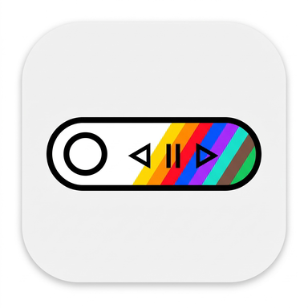
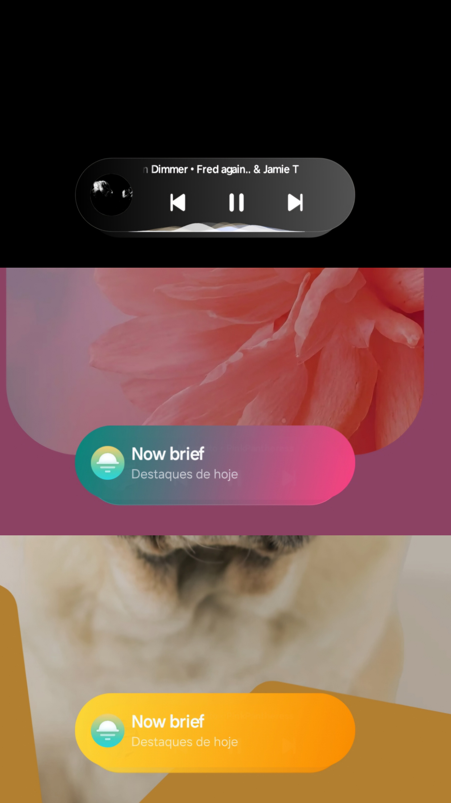

<div align="center">



# Now Bar Color

**Customize the collapsed Now Bar capsule background natively on Samsung One UI 8.0, 8.5, and 9.0+ (Lock Screen & AOD)**

[](https://github.com/TAVATAAN/OneUI-Now-Bar-Color/releases)
[](https://modules.lsposed.org/module/io.github.tavataan.nowbarcolor)
[](https://github.com/TAVATAAN/OneUI-Now-Bar-Color/releases/latest)
[](#features)
[](#license--author)

</div>

---

## Overview

**Now Bar Color** is an adaptive Xposed/LSPosed module for rooted Samsung Galaxy devices running **One UI 8.0, 8.5, and One UI 9.0+**. Since **v2.0.0**, it ships as a **single universal APK with isolated version adapters** powered by on-device **DexKit** bytecode scanning—operating dynamically against your installed `SystemUI` and `AOD_Service` without requiring a separate `AOD_Service` APK or root Suite ZIP.

It gives you full control over collapsed Lock Screen and Always On Display (AOD) Now Bar capsule backgrounds—**custom cropped photos with 6 pre-baked artistic styles**, solid colors with independent opacity, calibrated One UI 8.5-style glass **Color Blur**, smooth two-stop horizontal gradients, and wallpaper-adaptive palettes—while keeping album art, icons, action buttons, text legibility, and native animations intact.

It also includes a native One UI companion app featuring an interactive live capsule preview stage, an in-app pan-and-zoom capsule photo cropper, real-time animated audio waveforms, squircle vector badges with live color cutouts, per-category toggles, independent opacity/blur/scrim sliders, built-in compatibility diagnostics, and **English, Spanish, and Portuguese** localization.

> [!NOTE]
> **Early-Stage Project Notice, Tested Environments & RootTemporal Support**
>
> This project is still **very new and actively maintained**, so visual glitches or firmware-specific bugs can still occur on untested Galaxy models or `AOD_Service` builds. Future updates will continue expanding firmware coverage.
>
> - **RootTemporal (Locked Bootloader) Verified:** Tested on **RootTemporal** setups (devices running temporary root with a **locked bootloader**) via LSPosed/Vector, confirmed working cleanly without unlocking the bootloader or modifying system partitions.
> - **Direct Device / Custom ROM Port Testing** *(ported firmwares often embed `AOD_Service` APKs from newer Galaxy flagships, so untested factory stock builds may vary even when DexKit resolves dynamically)*:
>
> | Device | Environment & One UI | Verified `AOD_Service` Build (`versionCode`) | Adapter |
> | :--- | :--- | :--- | :--- |
> | **Galaxy S23 Ultra** | **Custom ROM / Port (`SM-S938B`)** — One UI 9.0 (Android 17) | `8.9.65.90` (`896590000`) & `8.9.67.3` (`896703000`) | `OneUi9Adapter` |
> | **Galaxy S20 FE (`SM-G780G`)** | **Custom ROM / Port** — One UI 8.5 (Android 16) | `8.9.32.89` (`893289000`) | `OneUi85Adapter` |
> | **Galaxy S22 Ultra** | **Custom ROM / Port (`SM-S901E`)** — One UI 8.0 (Android 16) | `8.9.15.39` (`891539000`) | `OneUi80Adapter` |
>
> If you encounter missing controls, reverted colors, or unmapped diagnostics on another stock ROM or port, please reach out on Telegram **[@Tava_Mon97](https://t.me/Tava_Mon97)** (use **Copy Diagnostics** inside the app) or open an issue on GitHub!

---

## Screenshots & Examples

Lock screen and AOD capsule collages showing custom solid colors, two-stop gradients, and translucent blurs across Now Brief, Music Media, Flashlight, and Samsung Health capsules *(captures from `v1.x`; updated photos, videos, and usage tutorials will be added in a future documentation pass — see the [`6-2.1.0` Release notes](https://github.com/TAVATAAN/OneUI-Now-Bar-Color/releases/tag/6-2.1.0) for live **Image Mode** previews)*:

<div align="center">

| Media & Now Brief Gradients | Flashlight, Health & Media Blur | Red Gradient, Dark Pill & Translucent Blur |
| :---: | :---: | :---: |
|  |  |  |

</div>

---

## Compatibility & Downloads (`v2.1.0`)

**v2.1.0 runs with a single universal APK (`NowBarColor.apk`)** across compatible **One UI 8.0, 8.5, and 9.0+** ROMs (`arm64-v8a`), including **RootTemporal** (locked bootloader) environments, factory firmware, and Custom ROM ports:

- **No separate `AOD_Service` APK required:** `AodScanner` inspects your installed `com.samsung.android.app.aodservice` via **DexKit**, caches a per-build `HookMap`, and automatically selects the isolated adapter for your One UI generation (`OneUi80Adapter`, `OneUi85Adapter`, or `OneUi9Adapter`).
- **No root Suite ZIP required or recommended for `v2.0.0+`:** Do **not** flash legacy `v1.x` root ZIPs over One UI 8.0 / 8.5 / 9.0+ setups—`v2.1.0` operates natively through LSPosed / Vector alone. *(Legacy `v1.3.0` artifacts remain archived strictly inside the [`4-1.3.0`](https://github.com/TAVATAAN/OneUI-Now-Bar-Color/releases/tag/4-1.3.0) release.)*

| Channel / Target | File / Catalog Entry | Description | Link |
| :--- | :--- | :--- | :--- |
| **GitHub Releases (`6-2.1.0`)** | `NowBarColor.apk` | Universal Adaptive Module APK (`v2.1.0`, `versionCode 6`) | [Download APK (v2.1.0)](https://github.com/TAVATAAN/OneUI-Now-Bar-Color/releases/download/6-2.1.0/NowBarColor.apk) |
| **LSPosed & Vector Repo** | `io.github.tavataan.nowbarcolor` | Official online repository listing & in-manager updates | [View in LSPosed / Vector Repo](https://modules.lsposed.org/module/io.github.tavataan.nowbarcolor) |

<details>
<summary><b>Upgrading from v1.x (Migration from <code>NowBar_LockScreen_Suite.zip</code> or replaced <code>AOD_Service.apk</code>)</b></summary>
<br>

If you previously installed **`v1.2.0`** or **`v1.3.0`**, remove the old system/port overrides before staying on `v2.0.0+` so your device no longer carries unnecessary `priv-app` mounts or outdated hooks:

1. **Update the module APK:** Install [`NowBarColor.apk` (`v2.1.0`)](https://github.com/TAVATAAN/OneUI-Now-Bar-Color/releases/download/6-2.1.0/NowBarColor.apk) over `v1.3.0` / `v2.0.0` (all releases share the exact same signing certificate).
2. **If you flashed `NowBar_LockScreen_Suite.zip` (One UI 8.0 / 8.5):**
   - Open **KernelSU**, **Magisk**, or **APatch Manager** → **Modules**.
   - Disable or remove **`NowBar_LockScreen_Suite`** and **`LockScreenFix_OU9`**.
   - Reboot your device cleanly.
3. **If you manually installed the `v1.x` standalone `AOD_Service.apk` on One UI 9.0+:**
   - *(Optional, to restore your ROM's factory `AOD_Service`)* run in a root shell:
     ```bash
     su -c "pm uninstall-system-updates com.samsung.android.app.aodservice"
     ```
   - Open **Now Bar Color** once so DexKit scans your restored factory `AOD_Service` build, then reboot.

</details>

---

## Installation Guide

1. Ensure **LSPosed** (or **Vector** / JingMatrix fork) is installed and active on your Samsung Galaxy device running **One UI 8.0, 8.5, or 9.0+** (including supported **RootTemporal** locked-bootloader setups).
2. Download and install [`NowBarColor.apk` (v2.1.0)](https://github.com/TAVATAAN/OneUI-Now-Bar-Color/releases/download/6-2.1.0/NowBarColor.apk) from GitHub Releases or the **LSPosed / Vector Repository**.
3. Open **LSPosed Manager** (or **Vector Manager**), enable **Now Bar Color**, and ensure its recommended scopes are checked:
   - **`System UI`** (`com.android.systemui`)
   - **`Always On Display`** (`com.samsung.android.app.aodservice`)
4. Open **Now Bar Color** once so DexKit scans and caches the `HookMap` for your `AOD_Service` build, then **reboot your device** *(recommended)* or run the dual-process restart below:
   ```bash
   su -c "pkill -f com.android.systemui; pkill -f com.samsung.android.app.aodservice"
   ```
5. *(Note on Galaxy Store updates)* If Samsung updates **Always On Display** (`AOD_Service`) later, open **Now Bar Color** (or tap **Re-scan** inside Diagnostics; `NowBarConfigProvider` also detects mismatched `versionCode` / timestamps on demand) and restart System UI / AOD or reboot.

---

## Troubleshooting

- **App reports module inactive (`Module Active (LSPosed): false`):** Confirm **Now Bar Color** is toggled ON in LSPosed / Vector Manager, verify both **`com.android.systemui`** and **`com.samsung.android.app.aodservice`** are checked in module scopes, and perform a full reboot.
- **Diagnostics shows `MISSING(...)` or `AMBIGUOUS(...)` slots:** Open the app's **Diagnostics** dialog and tap **Re-scan**. If slots remain unmapped (or show *Partial Compatibility*), tap **Copy Diagnostics** and send the full report to Telegram **[@Tava_Mon97](https://t.me/Tava_Mon97)** or GitHub Issues along with your device model and ROM details.
- **Capsule colors disappear after a Samsung Always On Display update:** Cached `HookMap` entries are bound to the previous `AOD_Service` `versionCode` and `lastUpdateTime`. Open **Now Bar Color** (or press **Re-scan** in Diagnostics) so DexKit indexes the new APK, then run `su -c "pkill -f com.android.systemui; pkill -f com.samsung.android.app.aodservice"` or reboot.
- **Glitches or duplicated cards after updating from `v1.x`:** Make sure legacy `NowBar_LockScreen_Suite` and `LockScreenFix_OU9` modules were disabled/uninstalled and rebooted (see **Upgrading from v1.x** above).

---

## Features

### Custom Capsule Photos (`v2.1.0`), Visual Finish Modes & Adaptive Palettes

| Finish Modes & Media | Adaptive Palettes & Legibility |
| :--- | :--- |
| **Custom Photo (`Image` Mode):** Pick any photo via Android's permission-free Photo Picker (`ACTION_PICK_IMAGES`), frame it inside an interactive pan-and-zoom pill cropper (`CapsuleCropDialog`), and bake safe-sized assets with 6 artistic styles (**Original**, **Glass Blur**, **Duotone** with Monet/Cyber/Sunset/Ocean/Crimson presets, **Noir**, **Pixel**, and **Cinema** vignette) globally or per capsule category. | **Legibility Scrim & Adaptive Contrast:** Live **Uniform** or **Reading Gradient** darkening scrim, dominant-tinted 1dp specular border, automatic white/dark text & icon contrast adaptation, and automatic `45%` AOD dimming (or full transparent hiding). |
| **Pure Solid Color:** Crisp solid capsule backgrounds with accurate `<100%` per-category opacity across Lock Screen Frame 0, standard capsules, and `NowBarMediaCardView` expand/collapse transitions. | **Wallpaper-Adaptive Color:** Extracts Lock Screen wallpaper **Bottom Zone**, **Monet Accent**, or **Dominant** primary/secondary tones live. |
| **Two-Stop Horizontal Gradients:** Smooth custom or preset two-color gradients globally or per capsule without GenUI layer double-painting. | **One UI 8.5 Glass Color Blur:** Calibrated `16px–100px` frosted blur, dedicated **Tint Opacity** (`25%–85%`), saturated `SemBlurInfo` ColorCurve rendering, and a subtle `~1dp` diagonal specular glass rim. |

### Granular Per-Category Control with Dynamic Vector Badges

Each of the **10 Now Bar capsule categories** includes a large One UI squircle badge with transparent vector cutouts dynamically backed by its active color, gradient, or custom cropped photo, plus independent toggles, overrides, and opacity sliders:

| Category | Target Component / Scope |
| :--- | :--- |
| **1. Music & Media Playback** | `NowBarMediaCardView` |
| **2. Clock, Timer & Stopwatch** | Standard & ongoing clock capsules |
| **3. Voice Recorder & Audio Memos** | Active recording chips |
| **4. Flashlight** | Quick toggle active capsule |
| **5. Live Battery & Charging** | `NowBarBatteryCardView` (including tall `>145dp` layouts) |
| **6. Now Brief / Galaxy AI Suggestions** | `NowBarBriefCardView` & GenUI pills |
| **7. Ongoing Phone Calls** | Active call status capsule |
| **8. Modes & Routines** | Active Bixby/System modes |
| **9. Sports, Maps & Samsung Health** | Navigation, live scores & workouts |
| **10. Other Live Activities** | Interpreter, Smart View & third-party ongoing chips |

### Under-the-Hood Architecture & Companion App

- **1 APK + Isolated One UI Adapters:** `AodScanner` uses native **DexKit** to resolve obfuscated `AOD_Service` / `FaceWidget` classes, methods, and fields on first run, persists a schema-versioned `HookMap` via `NowBarConfigProvider`, and dispatches cleanly through `NowBarAdapterFactory` (`OneUi80Adapter`, `OneUi85Adapter`, `OneUi9Adapter`).
- **Pre-Baked Image & Zero-Lag Render Pipeline:** `CapsuleImageProcessor` pre-bakes cropped photos once in the companion app (`CapsuleCropDialog`), streams them cleanly through `NowBarConfigProvider` (`openAssetFile`), and renders via lightweight LRU-cached `CapsuleImageDrawable` instances with hardware `RenderEffect`/stack blur parity and zero lag in `SystemUI` / `AOD_Service`.
- **Managed Solid & Glass Stabilization:** Intercepts card creation inside `NowBarCardStackView`, preserves `<100%` ARGB alpha in **Pure Solid** across Samsung `RoundRectDrawable.setAlpha(255)` stack fades and media collapse animators, suppresses native glow/gradient overlays, and prevents Compose/View double-painting on GenUI `NowBarBriefCardView`.
- **Native One UI Companion App:** Interactive `CapsulePreviewStage` replicating real wallpaper blur + glass sheen, animated `OneUIMediaCapsuleView` waveforms, `OneUIFloatingBar` navigation, `HsvColorPickerView`, built-in diagnostics export, and an **EN / ES / PT** language switcher.

---

## Building from Source

The repository includes a self-contained Python build script (`build.py`) compatible with Linux, Android (**Termux**), and desktop environments.

### Build Requirements

- **JDK 8+** (`javac`, `keytool`)
- **Android SDK Platform `android-34+`** (`--android-jar` or `ANDROID_HOME` / `ANDROID_SDK_ROOT`)
- **Android SDK Build Tools `35.0.0+` recommended** *(required for `zipalign -P 16` 16 KB ELF page alignment of `libdexkit.so` on Android 15+/16+; `build.py` falls back automatically to `-p` 4 KB alignment on `34.0.0`)*

### Compile & Sign

```bash
# 1. Clone the repository
git clone https://github.com/TAVATAAN/OneUI-Now-Bar-Color.git
cd OneUI-Now-Bar-Color

# 2. Run host verification tests (optional)
python3 tests/run_host_tests.py --android-jar <path-to-android.jar>

# 3. Build and sign the APK (auto-generates build/debug.keystore if absent)
python3 build.py
```

#### Keystore & Signing Reproducibility

- **Default debug signing:** When `--keystore` is omitted, `build.py` automatically creates (if absent) and reuses a local keystore at `build/debug.keystore` (`--alias androiddebugkey`, default password `android`).
- **Custom signing:** Supply your own keystore via flags and environment variables:
  ```bash
  export NOWBAR_STORE_PASS="your-store-password"
  export NOWBAR_KEY_PASS="your-key-password"
  python3 build.py --keystore /path/to/release.keystore --alias mykey
  ```
- **Repository hygiene:** `build/`, `*.keystore`, and `*.jks` are ignored in [`.gitignore`](.gitignore); **no private release keystore is stored in the Git repository**.

The signed APK is output to:

```text
build/NowBarColor.apk
```

---

## Project Structure

```text
├── AndroidManifest.xml & build.py  # Package manifest, provider, build & APK signing pipeline
├── meta_xposed/ & SCOPE & SUMMARY  # Xposed/LSPosed & Vector catalog metadata
├── assets/ & res/                  # xposed_init, preview art, vector icons & localization strings
├── src/.../nowbarcolor/
│   ├── MainActivity & CapsuleCrop  # Companion UI, interactive image cropper, PreviewStage & I18n
│   ├── NowBarHook.java & adapters  # Multi-layer Xposed hooks & OneUi80/85/9 isolated adapters
│   ├── AodScanner & HookMap        # On-device DexKit bytecode scanner, cache & ConfigProvider
│   └── CapsuleStyle, Image & Blur  # Solid, Gradient, pre-baked Image & 16–100px Color Blur
├── libs/                           # Prebuilt DexKit native/runtime JARs (see THIRD_PARTY_LICENSES.md)
├── LICENSES/                       # Full LGPL-3.0, GPL-3.0 & Apache-2.0 texts for libs/
└── tests/                          # Automated host unit test suite (run_host_tests.py)
```

---

## Feedback, Bug Reports & Support

Because **v2.1.0** is an early adaptive release tested primarily on ported firmwares and **RootTemporal** setups, diagnostics logs from other Galaxy models and stock builds help shape future updates! Reach out anytime:

- **Telegram:** [@Tava_Mon97](https://t.me/Tava_Mon97) *(recommended — include **Copy Diagnostics** from the app if reporting a bug)*
- **GitHub Issues:** [Report a bug or request a feature](https://github.com/TAVATAAN/OneUI-Now-Bar-Color/issues)

---

## License & Author

- **Module Source Code:** Distributed under the [MIT License](LICENSE).
- **Third-Party Libraries (`libs/`):** Includes prebuilt native **DexKit Core (`libdexkit.so`)** licensed under **GNU LGPL v3.0**, alongside **DexKit API (`dexkit.jar`)**, **FlatBuffers Java**, and **Kotlin Standard Library** under **Apache License 2.0**. Full attribution, upstream source links, SHA-256 checksums, and license texts are documented in **[THIRD_PARTY_LICENSES.md](THIRD_PARTY_LICENSES.md)**.
- **Author:** Developed by **tavataan** (Telegram: [@Tava_Mon97](https://t.me/Tava_Mon97)).
