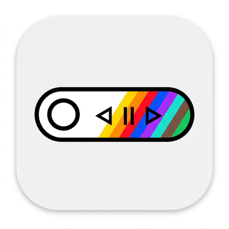
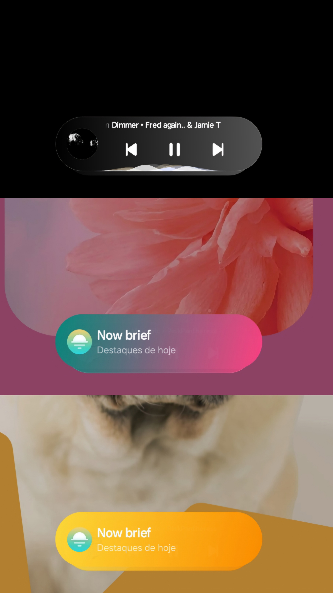
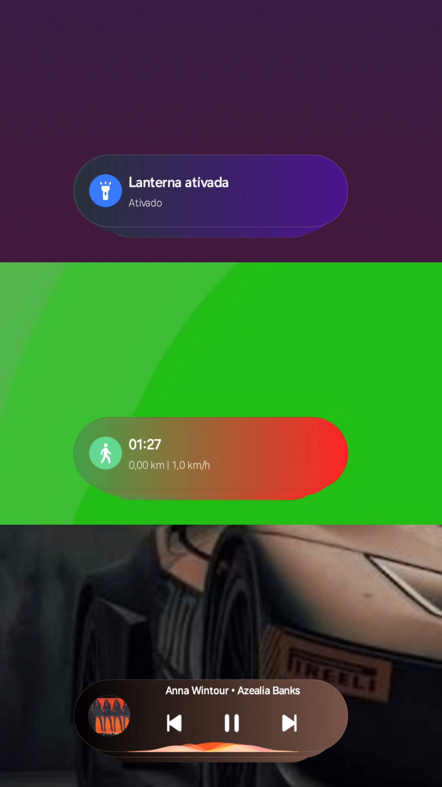
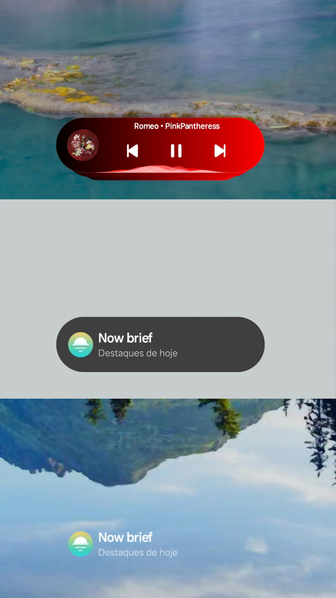

# Now Bar Color

<p align="center">
  <b>Customize the collapsed Now Bar capsule background on Samsung One UI 8.0+ & One UI 9.0+ (Lock Screen)</b><br>
  <i>LSPosed Module for Samsung Galaxy Devices</i>
</p>

<p align="center">
  
</p>

---

## Overview

**Now Bar Color** is an advanced LSPosed module designed for **Samsung Galaxy devices running One UI 8.0, 8.5, and One UI 9.0+**. It gives you complete control over the background styling of the collapsed **Now Bar** capsules on the lock screen—allowing you to apply solid colors, frosted-glass blur effects, smooth two-stop gradients, and adaptive wallpaper color palettes without altering album artwork, notification icons, text colors, or native system animations.

It includes a companion configuration app built with a native One UI interface, interactive live capsule previews with dynamic audio waveforms, large One UI squircle vector icons with transparent cutouts that dynamically preview each capsule's chosen color or gradient, per-category toggles, independent opacity sliders, and trilingual support (English, Spanish, and Portuguese). Under the hood, deep hooks in `SystemUI` and `FaceWidget/AOD` ensure zero-lag, instant styling from frame 0 with complete suppression of Samsung's default chip gradient overlays.

---

## 🚨🔴 IMPORTANT COMPATIBILITY WARNING (READ BEFORE INSTALLING) 🔴🚨

> [!CAUTION]
> 🚨 **CRITICAL ARCHITECTURE NOTICE — ONE UI 8.0 & 8.5 vs. ONE UI 9.0+** 🚨
>
> **Now Bar Color** was engineered specifically targeting Samsung's **`AODService` (`com.samsung.android.app.aodservice` v8.9.65.48)** from **One UI 9**.
>
> - 🔴 **Running One UI 8.0 or One UI 8.5? (SUITE REQUIRED):** Lower One UI versions do **NOT** include the One UI 9 `AODService` natively. Installing `NowBarColor.apk` alone will have no effect on One UI 8.x. You **MUST** flash the **`NowBar_LockScreen_Suite.zip`** All-in-One module (via **KernelSU, Magisk, or APatch**), which installs and stabilizes everything out of the box on the first boot!
> - ⛔ **Running One UI 9.0 or newer? (SUITE NOT NEEDED):** Do **NOT** flash the Suite ZIP! Your device already runs the native One UI 9 `AODService`. Simply install **`NowBarColor.apk`** directly and activate it in LSPosed.

---

## Download

All official files are available on the [Releases page](https://github.com/TAVATAAN/OneUI-Now-Bar-Color/releases/tag/3-1.2.0):

| File | Target One UI Version | Type | Direct Download |
|---|---|---|---|
| **`NowBarColor.apk`** | **One UI 9.0+** *(Standalone)* | LSPosed APK | [Download NowBarColor.apk (v1.2.0)](https://github.com/TAVATAAN/OneUI-Now-Bar-Color/releases/download/3-1.2.0/NowBarColor.apk) |
| 🚨 **`NowBar_LockScreen_Suite.zip`** | 🔴 **One UI 8.0 & One UI 8.5 ONLY** | All-in-One Root Module *(KernelSU / Magisk / APatch)* | [Download NowBar_LockScreen_Suite.zip (v1.2.0)](https://github.com/TAVATAAN/OneUI-Now-Bar-Color/releases/download/3-1.2.0/NowBar_LockScreen_Suite.zip) |

---

## Installation Tutorial

### 🔴 Option A: For One UI 8.0 & One UI 8.5 Devices (1-Step All-in-One Suite)

🚨 **Mandatory for One UI 8.0 / 8.5:** We have packaged a complete, ready-to-use **All-in-One Suite (`NowBar_LockScreen_Suite.zip`)** so everything works immediately on the very first installation without manual setup.

#### What is included inside `NowBar_LockScreen_Suite.zip`?
- **One UI 9 Core Lock Screen & AOD Apps** (`AODService` v8.9.65.48, `DressRoom`, `GalleryWidget`, and `SamsungGallery`) pre-configured for `priv-app` mounting.
- **Good Lock Companion Plugin** (`LockStar` v9.0.00.5) automatically installed with required system permissions.
- **`LockScreenFix` (LSPosed Module by TAVATAAN):** Stabilizes all ported One UI 9 lock screen, AOD, and gallery components on One UI 8.0 / 8.5.
- **`NowBarColor` v1.2.0 (LSPosed Module):** Full Now Bar background customization app and engine.
- **Automatic LSPosed SQLite Activation & Permissions:** Automatically registers and enables both `NowBarColor` and `LockScreenFix` directly inside LSPosed's configuration database (`modules_config.db`) with all required target scopes and runtime permissions (`WRITE_SETTINGS`, storage, calendar).

#### Steps for One UI 8.0 & 8.5:
1. Ensure **LSPosed Framework** (Zygisk or JingMatrix fork) is installed on your rooted device (**KernelSU**, **Magisk v26+**, or **APatch**).
2. Download [**`NowBar_LockScreen_Suite.zip`**](https://github.com/TAVATAAN/OneUI-Now-Bar-Color/releases/download/3-1.2.0/NowBar_LockScreen_Suite.zip).
3. Open **KernelSU**, **Magisk**, or **APatch** Manager, go to the **Modules** tab, and flash `NowBar_LockScreen_Suite.zip`.
4. **Reboot your device.**
5. **Done!** Both **`NowBarColor`** and **`LockScreenFix`** are **automatically activated in LSPosed** upon boot—**you do NOT need to enable them manually in LSPosed Manager**. Simply open the **Now Bar Color** app from your app drawer and customize your capsules!

---

### Option B: For One UI 9.0+ Devices (Standalone APK)

⛔ **Reminder:** If your ROM is already **One UI 9.0 or higher**, you do **NOT** need `NowBar_LockScreen_Suite.zip`.

1. Download and install [**`NowBarColor.apk`**](https://github.com/TAVATAAN/OneUI-Now-Bar-Color/releases/download/3-1.2.0/NowBarColor.apk) (or install/update directly from LSPosed Repository).
2. Open **LSPosed Manager** and enable **Now Bar Color** with its recommended scopes (`System UI` and `Always On Display`).
3. Restart System UI (`su -c killall com.android.systemui`) or reboot your device.
4. Open **Now Bar Color** from your launcher to configure your colors, gradients, blur, and per-capsule styles.

---

## Screenshots and Examples

Examples showing how custom colors blend dynamically with various lock screen wallpapers and categories:

<p align="center">
  
  
  
</p>

---

## Features

- **Visual Finish Modes**:
  - **Pure Solid Color**: Vibrant, high-contrast backgrounds.
  - **Two-Stop Horizontal Gradients**: Smooth custom or preset color transitions per capsule or globally.
  - **Color Blur**: Translucent frosted-glass blur effect with adaptive color mixing.
- **Adaptive Wallpaper Palette Extraction**:
  - **Bottom Zone**: Accurately samples the exact wallpaper region where the Now Bar rests.
  - **Monet Accent**: Uses the system's dynamic Material You color scheme.
  - **Dominant Background**: Matches the primary lock screen tone.
- **Granular Per-Category Control with Dynamic Vector Badges**:
  Each of the 10 Now Bar capsule categories features a large One UI squircle badge with transparent vector cutouts dynamically backed by its active color or gradient, plus independent toggles, color overrides, and opacity sliders:
  - **Music & Media Playback** (`NowBarMediaCardView`)
  - **Clock, Timer & Stopwatch**
  - **Voice Recorder & Audio Memos**
  - **Flashlight**
  - **Live Battery & Charging** (`NowBarBatteryCardView`)
  - **Now Brief / Galaxy AI Suggestions** (`NowBarBriefCardView`)
  - **Ongoing Phone Calls**
  - **Modes & Routines**
  - **Sports, Maps & Samsung Health**
  - **Other Live Activities** (Interpreter, Smart View, third-party ongoing chips)
- **Zero-Lag Hot Creation (Frame-0 Styling)**:
  - Deep hooks in `NowBarCardStackView` intercept newly created capsules in real time.
  - Complete suppression of Samsung's native notification chip gradient overlay (`NowBarCardGradientView`), ensuring newly triggered capsules render with your custom palette from frame 0 without flicker.
- **Native One UI Companion App**:
  - Real-time animated media capsule preview, interactive HSV pickers, and built-in language switcher (**English**, **Spanish**, and **Portuguese**).

---

## Building from Source

The repository includes a lightweight, self-contained Python build script (`build.py`) compatible with Linux/Android and desktop environments with Android SDK tools:

```bash
# 1. Clone the repository
git clone https://github.com/TAVATAAN/OneUI-Now-Bar-Color.git
cd OneUI-Now-Bar-Color

# 2. Build and sign the APK
python3 build.py
```

The signed APK will be generated at:
```text
build/NowBarColor.apk
```

---

## Project Structure

```text
├── AndroidManifest.xml          # Package definition, permissions, and LSPosed metadata
├── assets/                      # Module bootstrap (xposed_init)
├── docs/screenshots/            # Collage preview images
├── meta_xposed/                 # LSPosed repository metadata (module.prop, scope.list)
├── res/                         # Vector capsule icons, launcher icons, strings, and arrays
├── src/io/github/tavataan/nowbarcolor/
│   ├── MainActivity.java        # One UI settings activity with dynamic vector badges & Live Preview
│   ├── NowBarHook.java          # Core LSPosed hooking engine for SystemUI & FaceWidget/AOD
│   ├── CapsuleGradient.java     # Adaptive GradientDrawable tracking internal state mutations
│   ├── CapsuleStyle.java        # Styling pipeline managing Solid, Blur, and Gradient states
│   ├── ReflectionCache.java     # High-performance reflection cache for SystemUI fields/methods
│   ├── ConfigManager.java       # Configuration persistence and 10-category metadata/icons
│   ├── WallpaperColorHelper.java# Real-time wallpaper color extractor (Monet, Bottom Zone)
│   ├── OneUIMediaCapsuleView.java# Dynamic preview component with live audio waveform bars
│   ├── OneUISwitch.java         # Custom Samsung One UI-styled toggle switch
│   ├── HsvColorPickerView.java  # Touch-responsive HSV color picker
│   └── I18n.java                # Trilingual localization manager (EN, ES, PT)
├── tests/                       # Automated host test suite
└── build.py                     # Standalone compilation and packaging pipeline
```

---

## Feedback, Bug Reports & Support

If you encounter any bugs, have feature suggestions, or need help with setup, you can reach out through Telegram or open an issue on GitHub:

- Telegram: [@Tava_Mon97](https://t.me/Tava_Mon97)
- GitHub Issues: Report issues or submit pull requests directly on the repository tracker.

---

## License

This project is licensed under the **MIT License**. See the [LICENSE](LICENSE) file for details.

---

## Author

Developed by **tavataan** ([Telegram: @Tava_Mon97](https://t.me/Tava_Mon97)).
