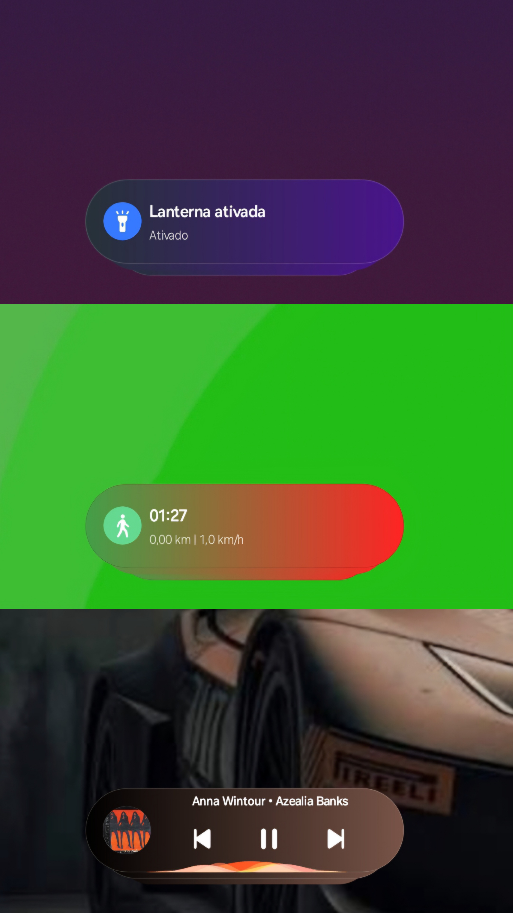

<div align="center">


# Now Bar Color

**Customize the collapsed Now Bar capsule background on Samsung One UI 8.0+ & One UI 9.0+ (Lock Screen)**

[](https://github.com/TAVATAAN/OneUI-Now-Bar-Color/releases)
[](https://github.com/LSPosed/LSPosed)
[](https://github.com/TAVATAAN/OneUI-Now-Bar-Color/releases/latest)
[](#features)
[](LICENSE)

</div>

---

## Overview

**Now Bar Color** is an advanced LSPosed module for Samsung Galaxy devices running **One UI 8.0, 8.5, and One UI 9.0+**. It provides full control over the background styling of collapsed lock screen Now Bar capsules—applying solid colors, frosted-glass blur effects, smooth two-stop horizontal gradients, and adaptive wallpaper palettes without altering album artwork, notification icons, text colors, or native system animations.

It includes a native One UI companion app with interactive live capsule previews, dynamic audio waveforms, large One UI squircle vector badges with transparent cutouts that preview each capsule's active color or gradient, per-category toggles, independent opacity sliders, and trilingual support (**English, Spanish, and Portuguese**). Deep hooks in `SystemUI` and `FaceWidget`/`AOD` deliver zero-lag styling from frame 0 while completely suppressing Samsung's default chip gradient overlays.

---

## Screenshots & Examples

Examples showing how custom colors, gradients, and blur effects blend dynamically with lock screen wallpapers and capsule categories:

<div align="center">

| Solid & Adaptive Palettes | Two-Stop Gradients | Frosted Blur & Companion UI |
| :---: | :---: | :---: |
|  |  |  |

</div>

---

## Compatibility & Downloads

> [!IMPORTANT]
> **Critical Architecture & `AOD_Service` Build Requirement — One UI 8.0 / 8.5 vs. One UI 9.0+**
>
> - **Having One UI 9 does NOT guarantee out-of-the-box compatibility:** Samsung's **`AOD_Service` (`com.samsung.android.app.aodservice`)** changes drastically across different device branches, models, and firmware builds.
> - **Mandatory Base `AOD_Service` Build (`896548000`):** It is **strictly mandatory** to run the exact same base build of `AOD_Service` used to develop this module—extracted from the **Galaxy S26 FE**, build **`896548000`** (`v8.9.65.48`). Running any other `AOD_Service` variant or branch will cause graphical glitches in the capsule or prevent the module from working entirely.
> - **Running One UI 8.0 or 8.5 (Suite Required):** Lower One UI versions do **not** include the One UI 9 `AODService` natively. Installing `NowBarColor.apk` alone will have no effect on One UI 8.x. You **must** flash `NowBar_LockScreen_Suite.zip` (via KernelSU, Magisk, or APatch), which installs and stabilizes the required components out of the box on the first boot.
> - **Running One UI 9.0 or newer (Standalone APK + Mandatory AOD_Service):** Do **not** flash the Suite ZIP. Your device runs One UI 9, but you **must** install the standalone **`AOD_Service.apk`** (`896548000`) provided in this release alongside `NowBarColor.apk`.

All official builds are available on the [Releases page](https://github.com/TAVATAAN/OneUI-Now-Bar-Color/releases):

| Target System | Package File | Package Type / Description | Direct Download |
| :--- | :--- | :--- | :--- |
| **All Supported Versions** | `NowBarColor.apk` | LSPosed Module APK (v1.3.0, `versionCode 4`) | [Download APK (v1.3.0)](https://github.com/TAVATAAN/OneUI-Now-Bar-Color/releases/download/4-1.3.0/NowBarColor.apk) |
| **One UI 9.0+ (Mandatory Base)** | `AOD_Service.apk` | S26 FE Base App (Build `896548000` / `v8.9.65.48`) | [Download AOD_Service.apk (896548000)](https://github.com/TAVATAAN/OneUI-Now-Bar-Color/releases/download/4-1.3.0/AOD_Service.apk) |
| **One UI 8.0 & 8.5 ONLY** | `NowBar_LockScreen_Suite.zip` | All-in-One Root Module (KernelSU / Magisk / APatch) | [Download Suite (v1.3.0)](https://github.com/TAVATAAN/OneUI-Now-Bar-Color/releases/download/4-1.3.0/NowBar_LockScreen_Suite.zip) |

---

## Installation Guide

### Option A: One UI 8.0 & 8.5 Devices (1-Step All-in-One Suite)

1. Ensure **LSPosed Framework** (Zygisk or JingMatrix/Vector fork) is installed on your rooted device (**KernelSU**, **Magisk v26+**, or **APatch**).
2. Download [`NowBar_LockScreen_Suite.zip`](https://github.com/TAVATAAN/OneUI-Now-Bar-Color/releases/download/4-1.3.0/NowBar_LockScreen_Suite.zip).
3. Open **KernelSU**, **Magisk**, or **APatch Manager**, go to the **Modules** tab, and flash `NowBar_LockScreen_Suite.zip`.
4. Reboot your device.
5. **Done!** Both `NowBarColor` and `LockScreenFix_OU9` are automatically activated in LSPosed upon boot—no manual setup in LSPosed Manager is needed. Open **Now Bar Color** from your app drawer to customize your capsules.

<details>
<summary><b>📦 What is included inside NowBar_LockScreen_Suite.zip? (Click to expand)</b></summary>
<br>

- **One UI 9 Core Lock Screen & AOD Apps:** `AODService` (`v8.9.65.48` / build `896548000` extracted from Galaxy S26 FE), `DressRoom`, `GalleryWidget`, and `SamsungGallery` pre-configured for `priv-app` mounting.
- **Good Lock Companion Plugin:** `LockStar` (`v9.0.00.5`) automatically installed with required system permissions.
- **LockScreenFix (LSPosed Module by TAVATAAN):** `LockScreenFix_OU9` v2.1.7 stabilizes all ported One UI 9 lock screen, AOD, media controls, and gallery components on One UI 8.0 / 8.5.
- **NowBarColor v1.3.0 (LSPosed Module):** Full Now Bar background customization app and hooking engine.
- **Automatic LSPosed SQLite Activation & Permissions:** Automatically registers and enables both `NowBarColor` and `LockScreenFix_OU9` directly inside LSPosed's configuration database (`modules_config.db`) with all required target scopes and runtime permissions (`WRITE_SETTINGS`, storage, calendar).

</details>

### Option B: One UI 9.0+ Devices (Standalone APK)

> [!NOTE]
> If your ROM is already on **One UI 9.0 or higher**, do **not** flash `NowBar_LockScreen_Suite.zip`.

1. Download [`AOD_Service.apk` (S26 FE — Build `896548000`)](https://github.com/TAVATAAN/OneUI-Now-Bar-Color/releases/download/4-1.3.0/AOD_Service.apk) and install it as an update over your system's Always On Display service.
   > 💡 **Troubleshooting Cross-Branch Installation Failure (KernelSU):**
   > If `AOD_Service.apk` fails to install as an update due to signature/branch verification differences across Samsung firmware branches, disable the official release check first by running the following command in a root terminal:
   > ```bash
   > su -c "/data/adb/ksu/bin/resetprop -n ro.build.official.release false"
   > ```
   > Then install `AOD_Service.apk` again.
2. Download and install [`NowBarColor.apk`](https://github.com/TAVATAAN/OneUI-Now-Bar-Color/releases/download/4-1.3.0/NowBarColor.apk) (or install/update directly from the LSPosed Repository).
3. Open **LSPosed Manager** and enable **Now Bar Color** with its recommended scopes (**System UI** and **Always On Display**).
4. Restart System UI (`su -c killall com.android.systemui`) or reboot your device.
5. Open **Now Bar Color** from your launcher to configure your colors, gradients, blur, and per-capsule styles.

---

## Features

### Visual Finish Modes & Adaptive Palettes

| Finish Modes | Adaptive Wallpaper Extraction |
| :--- | :--- |
| **Pure Solid Color:** Vibrant, high-contrast backgrounds. | **Bottom Zone:** Samples the exact wallpaper region where the Now Bar rests. |
| **Two-Stop Horizontal Gradients:** Smooth custom or preset transitions per capsule or globally. | **Monet Accent:** Uses the system's dynamic Material You color scheme. |
| **Color Blur:** Translucent frosted-glass blur effect with adaptive color mixing. | **Dominant Background:** Matches the primary lock screen tone. |

### Granular Per-Category Control with Dynamic Vector Badges

Each of the **10 Now Bar capsule categories** includes a large One UI squircle badge with transparent vector cutouts dynamically backed by its active color or gradient, plus independent toggles, color overrides, and opacity sliders:

| Category | Target Component / Scope |
| :--- | :--- |
| **1. Music & Media Playback** | `NowBarMediaCardView` |
| **2. Clock, Timer & Stopwatch** | Standard & ongoing clock capsules |
| **3. Voice Recorder & Audio Memos** | Active recording chips |
| **4. Flashlight** | Quick toggle active capsule |
| **5. Live Battery & Charging** | `NowBarBatteryCardView` |
| **6. Now Brief / Galaxy AI Suggestions** | `NowBarBriefCardView` |
| **7. Ongoing Phone Calls** | Active call status capsule |
| **8. Modes & Routines** | Active Bixby/System modes |
| **9. Sports, Maps & Samsung Health** | Navigation, live scores & workouts |
| **10. Other Live Activities** | Interpreter, Smart View & third-party ongoing chips |

### Under-the-Hood Architecture & Companion App

- **Zero-Lag Hot Creation (Frame-0 Styling):** Deep hooks in `NowBarCardStackView` intercept newly created capsules in real time, while complete suppression of Samsung's native notification chip gradient overlay (`NowBarCardGradientView`) ensures custom palettes render from frame 0 without flicker.
- **Native One UI Companion App:** Real-time animated media capsule preview with dynamic audio waveform bars, touch-responsive HSV color pickers, and a built-in language switcher (**English, Spanish, and Portuguese**).

---

## Building from Source

The repository includes a lightweight, self-contained Python build script (`build.py`) compatible with Linux, Android (Termux), and desktop environments with Android SDK tools installed:

```bash
# 1. Clone the repository
git clone https://github.com/TAVATAAN/OneUI-Now-Bar-Color.git
cd OneUI-Now-Bar-Color

# 2. Build and sign the APK
python3 build.py
```

The signed APK will be generated at:

```text
build/NowBarColor.apk
```

---

## Project Structure

```text
├── AndroidManifest.xml             # Package definition, permissions & LSPosed metadata
├── assets/                         # Module bootstrap (xposed_init)
├── docs/screenshots/               # Collage preview images
├── meta_xposed/                    # LSPosed repository metadata (module.prop, scope.list)
├── res/                            # Vector capsule icons, launcher icons, strings & arrays
├── src/io/github/tavataan/nowbarcolor/
│   ├── MainActivity.java           # One UI settings UI, dynamic vector badges & Live Preview
│   ├── NowBarHook.java             # Core LSPosed hooking engine for SystemUI & FaceWidget/AOD
│   ├── CapsuleGradient.java        # Adaptive GradientDrawable tracking internal mutations
│   ├── CapsuleStyle.java           # Styling pipeline managing Solid, Blur & Gradient states
│   ├── ReflectionCache.java        # High-performance reflection cache for SystemUI members
│   ├── ConfigManager.java          # Configuration persistence & 10-category metadata/icons
│   ├── WallpaperColorHelper.java   # Real-time wallpaper color extractor (Monet, Bottom Zone)
│   ├── OneUIMediaCapsuleView.java  # Dynamic preview component with live audio waveform bars
│   ├── OneUISwitch.java            # Custom Samsung One UI-styled toggle switch
│   ├── HsvColorPickerView.java     # Touch-responsive HSV color picker
│   └── I18n.java                   # Trilingual localization manager (EN, ES, PT)
├── tests/                          # Automated host test suite
└── build.py                        # Standalone compilation and packaging pipeline
```

---

## Feedback, Bug Reports & Support

If you encounter bugs, have feature suggestions, or need help with setup, reach out via Telegram or open an issue on GitHub:

- **Telegram:** [@Tava_Mon97](https://t.me/Tava_Mon97)
- **GitHub Issues:** [Report an issue or submit a pull request](https://github.com/TAVATAAN/OneUI-Now-Bar-Color/issues)

---

## License & Author

- **License:** Distributed under the [MIT License](LICENSE).
- **Author:** Developed by **tavataan** (Telegram: [@Tava_Mon97](https://t.me/Tava_Mon97)).
